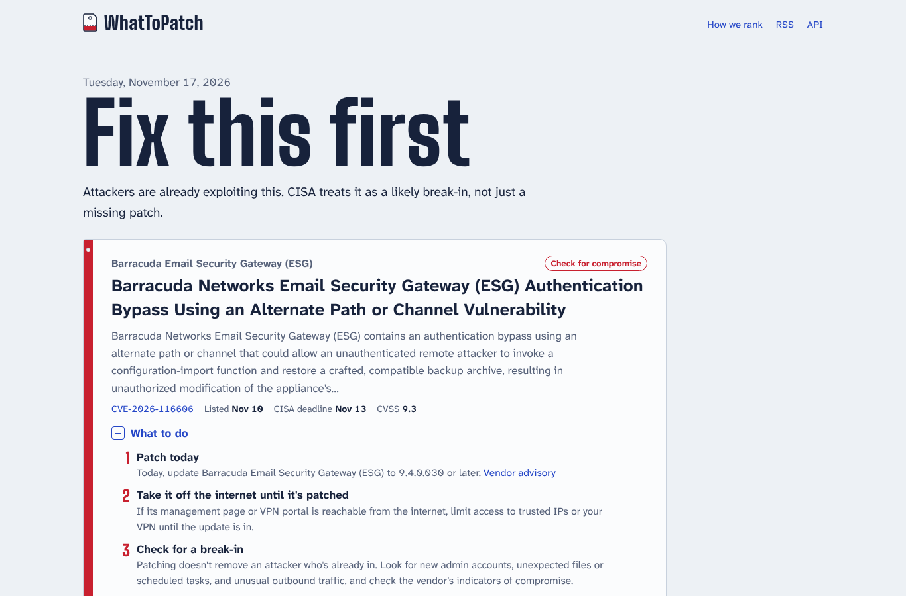

# WhatToPatch

**What attackers are exploiting right now, and exactly what to do about it.**

WhatToPatch is a triage board for vulnerabilities. Instead of another feed of every new CVE (more than 130 a day), it
answers three questions:

1. **What should I fix first?** Vulnerabilities are sorted into _Now_ (exploited in the wild), _This week_ (likely to be
   exploited soon) and _Watch_ (critical, no attacks yet), then ranked within each list.
2. **Does it affect me?** Pick the products you run (Fortinet, Exchange, VMware, WordPress…) and the board marks what
   hits your stack, plus every known-exploited flaw in those products since 2021. Your list never leaves your browser.
3. **What do I do?** Every item has plain-language steps: the fixed versions to upgrade to, what to do if you can't
   patch today, whether to check for a break-in, and CISA's deadline.



It runs on the free Vercel Hobby plan with no database: pages are prerendered and refreshed from the sources every
15 minutes.

## Data sources

Only primary, authoritative sources feed the ranking. News headlines are shown for context and never change the order.

| Source | What it's used for | Refresh |
| --- | --- | --- |
| [CISA Known Exploited Vulnerabilities](https://www.cisa.gov/known-exploited-vulnerabilities-catalog) | The backbone of _Now_: confirmed exploitation, ransomware use, CISA's remediation deadline and forensic-triage flag (BOD 26-04). Read from CISA's official [GitHub mirror](https://github.com/cisagov/kev-data), falling back to cisa.gov. | When CISA publishes |
| [CVE Program records](https://github.com/CVEProject/cvelistV5) | Affected and fixed versions, vendor solutions and workarounds, references, and CISA's SSVC analysis (exploitation, automatable, technical impact). | Every few minutes |
| [FIRST EPSS](https://www.first.org/epss/) | Probability of exploitation in the next 30 days. Drives _This week_. | Daily |
| [ENISA EUVD](https://euvd.enisa.europa.eu/) | New critical vulnerabilities (CVSS 9+) and ENISA's exploited list. | Continuous |
| [CIRCL Vulnerability-Lookup](https://vulnerability.circl.lu/) | Sightings: what's being talked about and reported as exploited. | Continuous |
| [Have I Been Pwned](https://haveibeenpwned.com/) | Newly added data breaches (CC BY 4.0, credited on the page). | Continuous |
| BleepingComputer, The Hacker News, SecurityWeek, Krebs on Security | Headlines only, linked to the publisher. | Continuous |

NIST's NVD is deliberately not used for ranking: its analysis backlog leaves many recent CVEs without scores. The CVE
records and CISA's own analysis are read directly instead.

## How the ranking works

- **Now**: on CISA KEV, listed as exploited by ENISA, reported exploited on CIRCL, or marked "active" in CISA's SSVC
  analysis.
- **This week**: EPSS of 10% or more, public exploit code with an automatable attack, or top-5% EPSS with CVSS 7+.
- **Watch**: CVSS 9+ published in the last week with low exploit odds.

Within each list the score weighs evidence of exploitation, ransomware use, CISA's forensic flag, EPSS, CVSS,
recency, and whether it's an internet-facing device (firewalls, VPNs, gateways). See `src/lib/triage.ts` and
`src/lib/advice.ts`.

## Deploy on Vercel (free)

1. Import this repository in Vercel (Add New > Project). No build settings to change.
2. Add environment variables (Project Settings > Environment Variables):
   - `NEXT_PUBLIC_SITE_URL`: your deployment URL, e.g. `https://whattopatch.vercel.app`
   - `CRON_SECRET`: a random string (`openssl rand -hex 32`). Protects the daily digest.
   - Optional: `NEXT_PUBLIC_REPO_URL` to show a "Source" link in the header.
3. Deploy.

### Daily digest (optional)

`vercel.json` schedules `/api/cron/digest` once a day at 11:00 UTC (the Hobby plan allows daily cron jobs). It sends the
vulnerabilities CISA added in the last day, with the first fix step, to any channel you configure:

- Telegram: `TELEGRAM_BOT_TOKEN` and `TELEGRAM_CHAT_ID` (create a bot with @BotFather)
- Discord: `DISCORD_WEBHOOK_URL`
- Slack: `SLACK_WEBHOOK_URL`

Preview the message without sending it with `curl -H "Authorization: Bearer $CRON_SECRET" "https://your-site/api/cron/digest?days=7&force=1&preview=1"`, and send a test with `?force=1`.

> The Hobby plan is for personal, non-commercial use. If you put ads, sponsorships or paid plans on it, move to Pro.

## Public endpoints

- `/feed.xml`: RSS of _Now_ and _This week_, with the steps for each item
- `/api/v1/radar`: the whole board as JSON
- `/api/v1/kev-index`: compact copy of the KEV catalog used for stack matching
- `/cve/CVE-YYYY-NNNN`: a page per vulnerability with status, fixed versions, vendor guidance and references

## Run locally

```bash
npm install
cp .env.example .env.local   # optional
npm run dev                  # http://localhost:3000
npm test                     # parsers, ranking and stack matching
npm run build
```

Built with Next.js 16 (Cache Components), React 19 and Tailwind CSS 4. Fonts: Big Shoulders and Atkinson Hyperlegible
Next, both under the SIL Open Font License.

## Privacy

No accounts, cookies or analytics. The products you pick are stored in your browser's `localStorage`. A shared link
puts the list in the URL fragment (`#stack=…`), which browsers never send to the server.

## Disclaimer

WhatToPatch is an independent project and is not affiliated with CISA, FIRST, ENISA, CIRCL, the CVE Program or Have I
Been Pwned. It ranks public data automatically and matches products by name, not version. Always confirm fixes against
the vendor's advisory before changing production systems.
